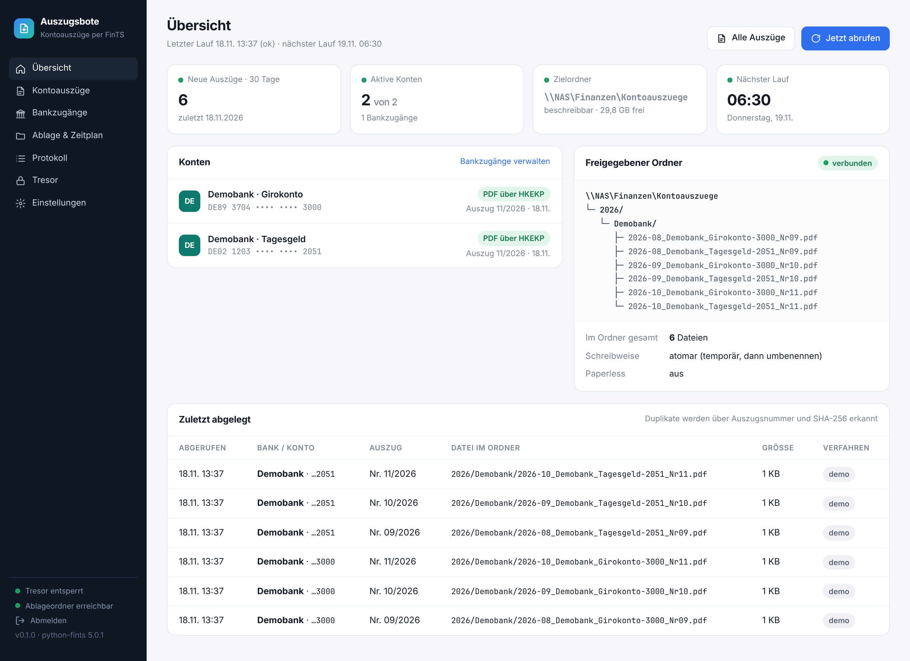
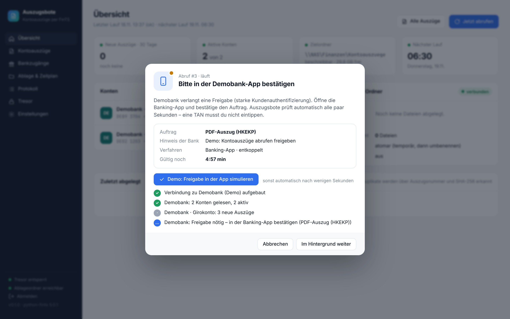
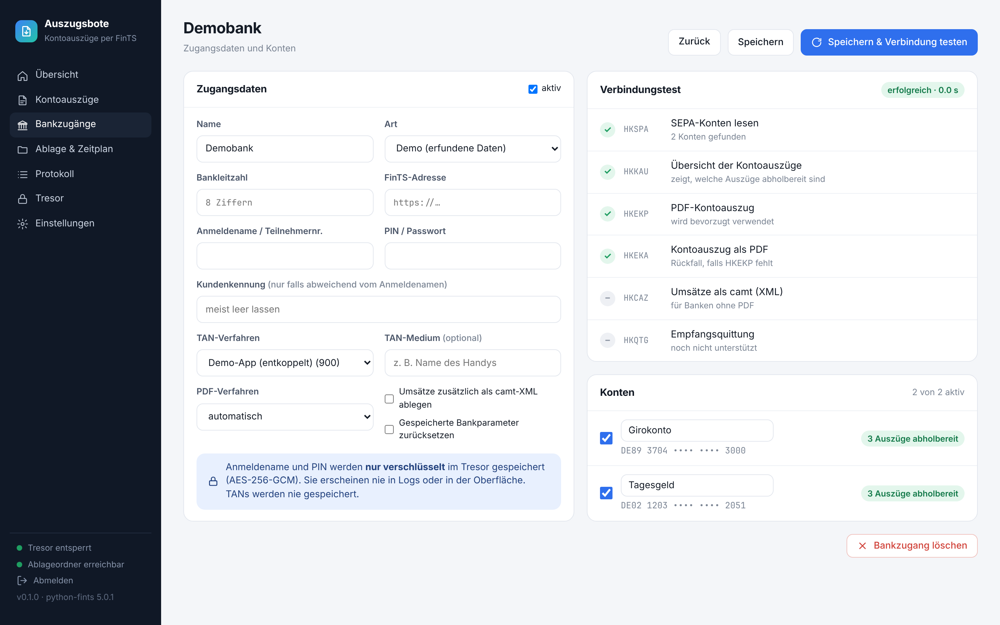
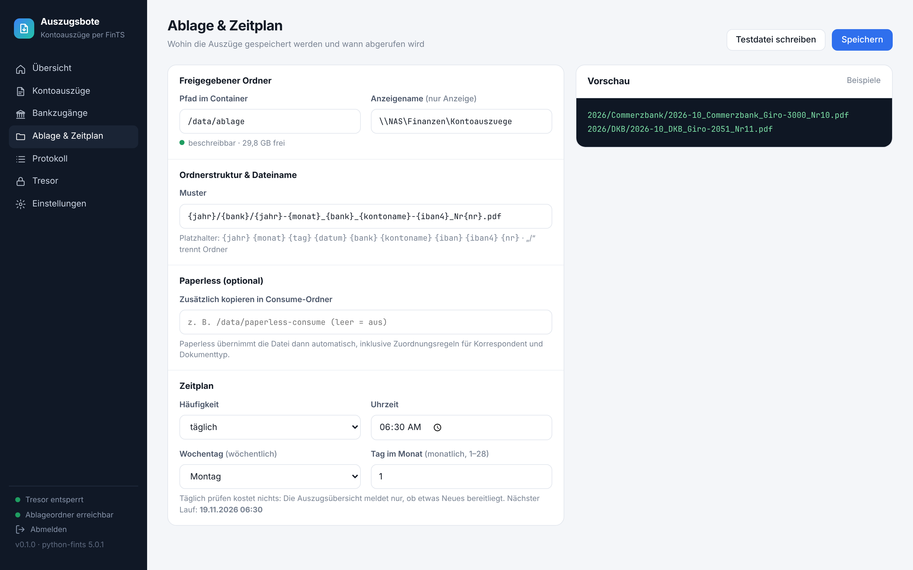

# Auszugsbote

**Holt deine Kontoauszüge per FinTS/HBCI automatisch bei deinen Banken ab und legt sie als PDF in einem freigegebenen Ordner ab.**
Selbst gehostet als Docker-Container, mit kleiner Weboberfläche, verschlüsseltem Tresor für die Zugangsdaten und Freigabe per Banking-App.



> **Status: frühes Grundgerüst (v0.1).** Der Demo-Modus läuft komplett. Der Abruf bei echten Banken ist
> implementiert, aber noch nicht gegen jede Bank getestet. Siehe [Grenzen](#grenzen--roadmap).

## Funktionen

- **PDF-Kontoauszüge per FinTS**: Auszugsübersicht (HKKAU), PDF über HKEKP oder HKEKA. Für Banken ohne PDF gibt es optional die Umsätze als camt-XML (HKCAZ).
- **Ablage im freigegebenen Ordner** (SMB/NFS/lokal), mit frei wählbarem Muster wie `2026/DKB/2026-10_DKB_Giro-2054_Nr11.pdf`.
  Dateien werden atomar geschrieben. Duplikate werden über Auszugsnummer und SHA-256 erkannt.
- **Optional Kopie in den Paperless-ngx-Consume-Ordner.**
- **Zeitplan**: täglich, wöchentlich, monatlich oder nur manuell.
- **Freigaben (starke Kundenauthentifizierung)**: entkoppelt per Banking-App (z. B. DKB-App, photoTAN-App, ING-App) mit automatischem Polling, alternativ TAN-Eingabe in der Oberfläche. Optional Push über Home Assistant.
- **Tresor**: PIN, Login, Produkt-ID und FinTS-Sitzung liegen AES-256-GCM-verschlüsselt in `vault.db`. Der Schlüssel kommt aus einem Docker-Secret oder einem Master-Passwort.
- **Demo-Modus** mit erfundenen Konten, damit du alles ausprobieren kannst, bevor du eine FinTS-Produkt-ID hast.

| Freigabe per App | Bankzugang mit Verbindungstest | Ablage & Zeitplan |
|---|---|---|
|  |  |  |

## Schnellstart mit Docker Compose

```bash
mkdir auszugsbote && cd auszugsbote
curl -O https://raw.githubusercontent.com/boberbeck/auszugsbote/main/docker-compose.yml
curl -o .env https://raw.githubusercontent.com/boberbeck/auszugsbote/main/.env.example
mkdir -p data secrets
docker run --rm boberbeck/auszugsbote genkey > secrets/vault_key
chmod 0400 secrets/vault_key && sudo chown 1000:1000 secrets/vault_key data
```

Trage in `.env` den Zugang zur SMB-Freigabe ein, oder hänge in `docker-compose.yml` einen Host-Ordner ein (Variante B). Dann:

```bash
docker compose up -d
```

Öffne `http://<server>:8080`:
1. Login-Passwort festlegen. Ist die Schlüsseldatei da, wird der Tresor automatisch damit eingerichtet.
2. Unter **Ablage & Zeitplan** prüfen, ob der Ordner beschreibbar ist.
3. **Bankzugang hinzufügen**: zum Ausprobieren die *Demobank* wählen, dann **Jetzt abrufen**.

> Die Oberfläche gehört **nur ins Heimnetz** oder hinter einen Reverse-Proxy mit eigener Anmeldung.
> Setze hinter HTTPS `AUSZUGSBOTE_HTTPS=1`, damit das Sitzungs-Cookie nur über HTTPS geht.

## FinTS-Produkt-ID beantragen

Seit 2019 muss jede FinTS-Software bei der Deutschen Kreditwirtschaft registriert sein. python-fints verlangt deshalb eine eigene **Produkt-ID**.

1. Registrierungsformular von [fints.org](https://www.fints.org) (Hersteller → Produktregistrierung) herunterladen und ausfüllen.
   - Art: *Neuer Eintrag*. Als Privatperson trägst du deinen Namen als Produkteigner ein.
   - Produktkategorie: **Web-Server**.
   - Den „Verteiler“ ankreuzen: Dann bekommst du die aktuelle FinTS-Bankenliste mit allen Server-Adressen.
2. Das Formular an `registrierung@hbci-zka.de` senden. Die Registrierung ist kostenlos und dauert meist bis zu zwei Wochen.
3. Die Nummer unter **Einstellungen → FinTS-Produkt-ID** eintragen. Sie wird verschlüsselt im Tresor gespeichert.

**Die Produkt-ID ist persönlich**: nicht veröffentlichen, nicht committen und nicht in Issues posten.

## Banken

| Bank | FinTS-Adresse | PDF-Auszug | Hinweise |
|---|---|---|---|
| Commerzbank | `https://fints.commerzbank.de/fints` | HKEKA (PDF) | Kontoauszug auf das elektronische Postfach umstellen, dann ist der FinTS-Abruf aktiv. Login = Teilnehmernummer. Freigabe per photoTAN-App. |
| DKB | `https://fints.dkb.de/fints` | HKEKP (signiertes PDF) | Die alte Adresse `…s-fints-pt-dkb.de` ist seit 30.09.2025 abgeschaltet. Meldet die Bank „nicht freigeschaltet“, muss der DKB-Support HKEKP freischalten. |
| ING | `https://fints.ing.de/fints/` | eher nicht | Umsätze als camt sind möglich. python-fints behandelt ING mit Ein-Schritt-Anmeldung. |
| Raisin & Co. | – | – | Kein FinTS-Zugang. |

Der **Verbindungstest** zeigt pro Bank, welche Geschäftsvorfälle wirklich angeboten werden. Ergänzungen zu weiteren Banken sind willkommen.

## Sicherheit: Was liegt wo?

| Was | Wo | Schutz |
|---|---|---|
| Bank, BLZ, FinTS-Adresse, Ordner, Zeitplan | `/data/config.yaml` | kein Geheimnis |
| PIN, Login, FinTS-Sitzung (System-ID, BPD/UPD), Produkt-ID, HA-Token | `/data/vault.db` | AES-256-GCM, je Eintrag eigener Nonce, Eintragsname als AAD |
| Tresor-Schlüssel | Docker-Secret `/run/secrets/vault_key` | Datei 0400, getrennt vom Backup aufbewahren |
| Abgelegte Auszüge (Nummer, Prüfsumme), Protokoll | `/data/state.db` | kein Geheimnis |
| TANs, App-Freigaben | – | werden nie gespeichert |

- Ohne Schlüsseldatei wird der Tresor mit einem **Master-Passwort** geschützt (Argon2id, 64 MiB). Nach jedem Neustart musst du dann in der Oberfläche entsperren.
- Der Web-Login nutzt ein Argon2id-gehashtes Passwort. Sitzungen laufen nach 12 Stunden ab. Alle POST-Anfragen sind gegen CSRF geschützt.
- Ins Protokoll kommen keine PINs, TANs oder Kontoinhalte. python-fints selbst ist auf `WARNING` gestellt.

## Konfiguration

| Variable | Standard | Bedeutung |
|---|---|---|
| `AUSZUGSBOTE_DATA` | `/data` | Datenverzeichnis (Konfiguration, Tresor, Zustand) |
| `AUSZUGSBOTE_VAULT_KEYFILE` | `/run/secrets/vault_key` | Schlüsseldatei für den Tresor |
| `AUSZUGSBOTE_PORT` | `8080` | Port der Weboberfläche |
| `AUSZUGSBOTE_HTTPS` | `0` | `1` = Sitzungs-Cookie nur über HTTPS |
| `AUSZUGSBOTE_SESSION_SECRET` | zufällig | fester Schlüssel für Sitzungen (sonst nach Neustart neu anmelden) |
| `FORWARDED_ALLOW_IPS` | `127.0.0.1` | vertrauenswürdige Reverse-Proxys |
| `TZ` | `Europe/Berlin` | Zeitzone für den Zeitplan |

**Platzhalter im Ablage-Muster:**
- `{jahr}`, `{monat}`, `{tag}` und `{datum}` beziehen sich auf das Ende des Auszugszeitraums.
- `{bank}`, `{kontoname}`, `{iban}` und `{iban4}` (die letzten 4 Stellen) beschreiben Bank und Konto.
- `{nr}` ist die Auszugsnummer.
- Mit `/` legst du Unterordner an.

Eine Beispielkonfiguration liegt in [`config.example.yaml`](config.example.yaml).

**Kommandozeile:**

```bash
auszugsbote genkey
```

```bash
auszugsbote abrufen
```

```bash
auszugsbote serve --port 8080
```

## Entwicklung

```bash
python3 -m venv .venv && . .venv/bin/activate
pip install -e ".[dev]"
pytest -q
```

```bash
AUSZUGSBOTE_DATA=./data AUSZUGSBOTE_VAULT_KEYFILE=./secrets/vault_key python -m auszugsbote serve --port 8080
```

Aufbau:

| Datei | Inhalt |
|---|---|
| `src/auszugsbote/config.py` | YAML-Konfiguration |
| `vault.py` | Tresor |
| `state.py` | SQLite-Zustand |
| `storage.py` | Ablage |
| `runner.py` | Abruf-Läufe und Freigaben |
| `scheduler.py` | Zeitplan |
| `banks/fints_bank.py` | python-fints inkl. eigenem HKEKP-Segment |
| `banks/demo.py` | Demobank |
| `web/` | FastAPI, Jinja2 und HTMX |

## Docker-Image veröffentlichen (für Maintainer)

Der Workflow [`.github/workflows/docker.yml`](.github/workflows/docker.yml) testet jeden Push. Das Image baut er für `linux/amd64` und `linux/arm64`:
- Ein Push auf `main` erzeugt den Tag `edge`.
- Ein Versions-Tag `vX.Y.Z` erzeugt die Tags `X.Y.Z`, `X.Y` und `latest`.

Ziele sind immer `ghcr.io/<owner>/auszugsbote` und zusätzlich **Docker Hub**, sobald die Repository-Secrets `DOCKERHUB_USERNAME` und `DOCKERHUB_TOKEN` gesetzt sind. Der Token wird auf Docker Hub unter *Account Settings → Personal access tokens* mit Read & Write erstellt. Bei Releases übernimmt der Workflow die README als Beschreibung auf Docker Hub.

```bash
git tag v0.1.0
```

```bash
git push origin v0.1.0
```

## Grenzen & Roadmap

- **HKEKP ist experimentell.** python-fints 5.0.1 implementiert HKEKP nicht, das Segment ist hier nach dem Muster von HKEKA nachgebaut. Scheitert es, fällt Auszugsbote auf HKEKA (PDF) zurück. Rückmeldungen von DKB-Nutzern sind willkommen.
- Empfangsquittung (HKQTG) fehlt noch. Banken, die eine Quittung erwarten, melden den Auszug eventuell weiter als neu. Duplikate werden trotzdem erkannt.
- Banken ohne Auszugsübersicht (HKKAU) werden für PDFs noch nicht unterstützt.
- Geplant: TOTP für den Login, Import der offiziellen FinTS-Bankenliste, mehr Bank-Vorlagen, Benachrichtigung per E-Mail.

## Haftungsausschluss

Auszugsbote ist ein privates Open-Source-Projekt. Es steht in keiner Verbindung zu den genannten Banken oder zur Deutschen Kreditwirtschaft. Die Nutzung erfolgt auf eigenes Risiko.
Prüfe deine Kontoauszüge weiterhin selbst. Halte dich an die Bedingungen deiner Bank für den Online-Zugang.

## Lizenz

[MIT](LICENSE). Verwendete Bibliotheken unter anderem: [python-fints](https://github.com/raphaelm/python-fints) (LGPL-3.0), [htmx](https://htmx.org) (BSD-2-Clause, mitgeliefert unter `web/static/htmx.min.js`), FastAPI, cryptography, argon2-cffi und APScheduler.
